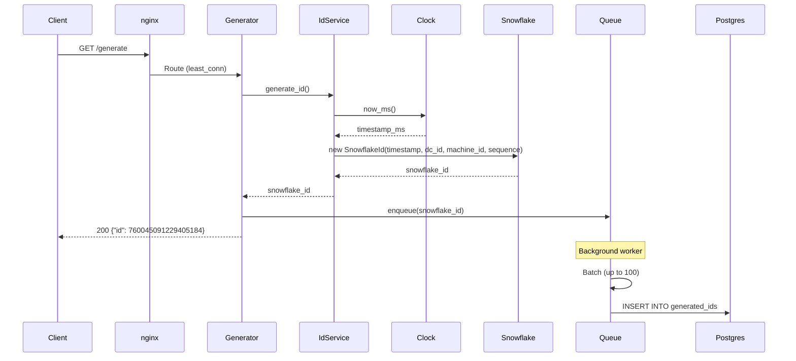

# Unique ID Generator Distributed

A distributed Snowflake-style ID generator capable of 10,000+ RPS with PostgreSQL persistence and real-time monitoring.

## Requirements

- ✅ Unique, sortable 64-bit numeric IDs
- ✅ Ordered by generation timestamp
- ✅ 10,000+ IDs per second per instance
- ✅ Horizontally scalable across 3+ instances

## Architecture

```
                    ┌─────────────────────────────────────┐
                    │              nginx                 │
                    │          (least_conn LB)           │
                    └──────────┬──────────┬──────────┬─────┘
                             │          │          │
              ┌──────────────┴──┐  ┌───┴────┐  ┌──┴───────────┐
              │  Generator 1   │  │   G2   │  │  Generator 3  │
              │  :5001 (dc-1,m1)│  │:5002   │  │ :5003 (dc-1,m3)│
              └────────┬─────────┘  └───┬────┘  └───────┬───────┘
                       │              │                │
                       └──────────────┼────────────────┘
                                     │
                              ┌──────┴──────┐
                              │ PostgreSQL │
                              │  :5432    │
                              └───────────┘
```

## Sequence Diagram



## Quick Start

```bash
# Start all services
docker compose up -d

# Generate an ID
curl http://localhost/generate
# {"id":760045091229405184}

# Check health
curl http://localhost/health
# {"status":"ok","instance":"dc-1-machine-1","uptime_seconds":123.45}

# View dashboard
open http://localhost:3000
```

## API Endpoints

| Endpoint | Method | Description |
|----------|--------|-------------|
| `/generate` | GET | Generate a unique Snowflake ID |
| `/health` | GET | Instance health status |
| `/metrics` | GET | Prometheus metrics |

## Snowflake ID Structure

```
┌────────────────────────────────────────────────────────────────────────┐
│                         64-bit Snowflake ID                             │
├────────────────────────┬───────────┬───────────┬────────────────────────┤
│    Timestamp (42b)    │  DataCenter│  Machine  │      Sequence         │
│  milliseconds since   │   ID (5b) │   ID (5b) │       (12b)          │
│    2021-01-01 UTC    │   0-31    │   0-31    │      0-4095          │
└────────────────────────┴───────────┴───────────┴────────────────────────┘
```

**Epoch:** January 1, 2021 00:00:00 UTC

## Tech Stack

| Component | Technology |
|-----------|------------|
| Generator | Python + FastAPI |
| Load Balancer | nginx |
| Database | PostgreSQL |
| Dashboard | HTML + Vanilla JS |

## Project Structure

```
src/generator/
├── domain/
│   ├── models/snowflake_id.py      # 64-bit ID model
│   ├── services/id_generator.py    # Snowflake algorithm
│   └── ports/                      # Interfaces (IClock, IIdPersistence)
├── infrastructure/
│   ├── adapters/
│   │   ├── system_clock.py         # System time
│   │   ├── async_pg_repository.py # PostgreSQL persistence
│   │   └── degradable_repository.py # Circuit breaker
│   └── persistence/
│       └── async_queue.py         # Batch write queue
└── interfaces/
    ├── http/router.py             # /generate endpoint
    ├── health/controller.py       # /health endpoint
    └── metrics/controller.py      # /metrics endpoint
```

## Key Features

- **Non-blocking persistence** — IDs returned immediately, DB writes async
- **Batch inserts** — Up to 100 IDs per PostgreSQL write
- **Graceful degradation** — Service continues if DB fails (circuit breaker)
- **Horizontal scaling** — Add instances behind nginx
- **Unique IDs** — Guaranteed unique within a machine (sequence)

## Documentation

- [System Architecture](docs/200.design/01-architecture/201.system-architecture.md)
- [API Contracts](docs/100.planning/103-functional/contracts/openapi.yaml)
- [Database Schema](docs/200.design/03-database/203.database-schema.md)
