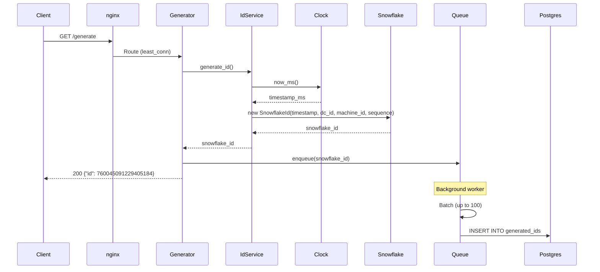

# Phase 201 — System Architecture

## Overview
This document defines the complete system architecture for the Unique ID Generator distributed service.

## ID Generation Flow

### Step-by-Step Enumeration

| Step | Component | Action | Description |
|------|-----------|--------|-------------|
| 1 | Client | `GET /generate` | HTTP request to nginx |
| 2 | nginx | Route to generator | least_conn picks Generator 1 |
| 3 | FastAPI | Receive request | `router.py:generate_id()` |
| 4 | IdGeneratorService | `generate_id()` | Domain logic called |
| 5 | SystemClock | `now_ms()` | Gets current timestamp |
| 6 | SnowflakeId | Construct 64-bit ID | Bit shifting and OR |
| 7 | AsyncWriteQueue | `enqueue()` | Non-blocking queue insert |
| 8 | JSONResponse | Return `{"id": ...}` | HTTP 200 to client |
| 9 | AsyncWriteQueue | Background worker | Batches and persists async |

---

## Sequence Diagram: Request Flow



---

## Step-by-Step: Generate an ID

### Step 1: HTTP Request
```
Client → nginx → Generator:5001
```

### Step 2: FastAPI Router
```python
# router.py:14-30
@router.get("/generate")
async def generate_id(request: Request) -> Response:
    snowflake_id = request.app.state.id_generator.generate_id()
    if request.app.state.write_queue:
        request.app.state.write_queue.enqueue(snowflake_id)
    return JSONResponse(content={"id": snowflake_id.value})
```

### Step 3: IdGeneratorService
```python
# id_generator.py:56-96
def generate_id(self) -> SnowflakeId:
    timestamp_ms = self._clock.now_ms()

    if timestamp_ms < self._last_timestamp_ms:
        raise ClockBackwardsError(...)
    if timestamp_ms == self._last_timestamp_ms:
        self._sequence = (self._sequence + 1) & 4095
        if self._sequence == 0:
            while self._clock.now_ms() == self._last_timestamp_ms:
                pass
            timestamp_ms = self._clock.now_ms()
    else:
        self._sequence = 0

    self._last_timestamp_ms = timestamp_ms
    id_value = ((timestamp_ms - EPOCH) << 22) | (dc_id << 17) | (machine_id << 12) | sequence
    return SnowflakeId(value=id_value)
```

### Step 4: Non-blocking Persistence
```python
# async_queue.py:56-68
def enqueue(self, snowflake_id: SnowflakeId) -> None:
    try:
        self._queue.put_nowait(IdRecord(snowflake_id=snowflake_id))
    except asyncio.QueueFull:
        self._dropped_count += 1
        logger.warning("persistence_queue_full_dropping_record", ...)
```

### Step 5: Background Batch Worker
```python
# async_queue.py:70-94
async def _worker(self) -> None:
    batch = []
    while self._running:
        record = await asyncio.wait_for(self._queue.get(), timeout=0.01)
        batch.append(record.snowflake_id)
        if len(batch) >= 100:
            await self._flush(batch)
            batch = []
```

### Step 6: Flush to PostgreSQL
```python
# async_pg_repository.py:70-88
async def persist_batch(self, snowflake_ids: list[SnowflakeId]) -> None:
    records = [(sid.value, sid.timestamp_ms, sid.datacenter_id,
                sid.machine_id, sid.sequence, json.dumps({})) for sid in snowflake_ids]
    async with self._pool.acquire() as conn:
        await conn.executemany(
            "INSERT INTO generated_ids (...) VALUES (... ON CONFLICT DO NOTHING",
            records
        )
```

---

## Summary Table

| Step | Time | Component | Action |
|------|-------|-----------|--------|
| 1 | 0ms | Client | `GET /generate` |
| 2 | ~1ms | nginx | Route to generator |
| 3 | ~2ms | IdGeneratorService | Generate 64-bit ID |
| 4 | ~3ms | AsyncWriteQueue | Enqueue (non-blocking) |
| 5 | ~3ms | JSONResponse | Return to client |
| 6 | ~10ms | Background | Batch insert to PostgreSQL |

**Total blocking time for client: ~3-5ms**
**PostgreSQL write happens asynchronously**

---

## Architecture Decisions

| Decision | Rationale |
|----------|-----------|
| least_conn LB | Best for varying request times |
| Async queue | Non-blocking ID generation |
| Batch inserts | Reduce DB round-trips |
| Circuit breaker | Graceful degradation |
| Singleton IdGenerator | Maintains sequence per instance |
